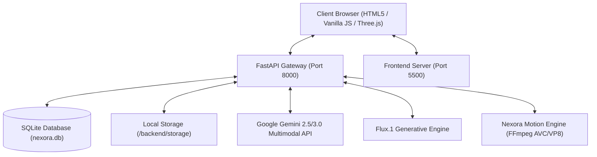

# NEXORA AI — Comprehensive Multimodal Implementation Master Report

**Tagline**: *"One Intelligence. Infinite Possibilities."*  
**Platform**: Nexora AI Multimodal Platform  
**Architecture**: Python 3.14 + FastAPI + Three.js WebGL + SQLite + Gemini Generative AI  
**Release**: v2.5 Multimodal Master  
**Date**: November 2026  

---

## 1. System Architecture Overview

Nexora AI is a production-grade multimodal generative AI platform delivering unified conversational reasoning, computer vision, document intelligence with Retrieval-Augmented Generation (RAG), text-to-image batch synthesis, text-to-video and image-to-video motion synthesis, and two-way voice communication with an interactive 3D WebGL humanoid assistant.

---

## 2. Multimodal Capability Matrix & Feature Implementation

### 2.1 Document Intelligence & RAG Knowledge Base
- **PDF Page-Wise Extraction**: Implemented via `pypdf.PdfReader`. Extracted text contains explicit page delimiters (`--- [Page X] ---`) and metadata.
- **Scanned PDF Heuristic**: Automatically flags PDFs as `is_scanned: True` when average character count is under 25 chars/page.
- **DOCX Parsing with Tables**: Uses `python-docx` to extract styled headings and convert Word XML tables into Markdown tables.
- **CSV Analytics & Pandas Statistics**: Analyzes tabular datasets, extracting row counts, column types, null values, numerical minimums, means, and maximums, rendering a formatted 10-row preview grid.
- **Document Comparison Engine**: Computes Jaccard vocabulary overlap percentage, shared core vocabulary, and unique lexical items across two documents.
- **RAG Semantic Search**: In-memory dense vector embedding using deterministic character 3-gram and word frequency hashing. Performs cosine similarity scoring boosted by exact lexical matches.
- **Prompt Injection Defense**: Encapsulates retrieved document chunks within strict `<source_document>` containers, instructing the LLM to treat document text as untrusted source facts only.

### 2.2 Advanced Image Understanding & Visual Analysis
- **Multi-Image Staging**: The universal file upload pipeline supports multiple simultaneous image attachments (`multiple` attribute enabled).
- **Native Binary Input to Gemini**: Direct conversion to `types.Part.from_bytes(data=bytes, mime_type=mime)` ensuring high-resolution visual comprehension, OCR, chart analysis, and visual comparisons.

### 2.3 Image Generation Studio Enhancements
- **Multi-Image Variations (Quantity 1–4)**: Added interactive pill selector (`1 Image`, `2 Variations`, `3 Variations`, `4 Variations`).
- **Batch Endpoint (`/api/image/generate-batch`)**: Generates 1 to 4 distinct variations using deterministic sub-seed variations (`seed + i * 1337`).
- **One-Click Regenerate**: In-chat and studio regenerate buttons re-trigger generation with the exact prompt and style parameters.
- **Unique Media IDs**: Every generated image receives a `uuid.uuid4()` identifier, preventing SQLite constraint collisions.

### 2.4 Audio Understanding & Voice Synthesis
- **Audio File Understanding**: Ingestion of WAV, MP3, M4A, WEBM, and OGG. Uses Gemini audio comprehension to deliver transcripts, executive summaries, and speaker identification.
- **Speech Synthesis Controls**: Integrated Volume slider (`#setting-voice-volume`), Playback rate selector (`#setting-voice-rate`), Voice selector, and Auto-speak toggle.
- **State Synchronization**: Audio playback triggers the 3D robot's `speaking` state, resetting to `idle` upon completion or pause.

### 2.5 AI Video Studio (Text-to-Video & Image-to-Video)
- **Asynchronous Video Jobs**: Background rendering via FastAPI `asyncio.create_task` with real-time job status polling (`/api/video/jobs/{id}`).
- **Dual-Codec Video Synthesis**: FFmpeg renders both web-optimized H.264 MP4 (`yuv420p`, `+faststart`) and WebM VP8.
- **Image-to-Video Animation**: Added keyframe reference image input (`#vid-studio-image-url`, `#vid-ref-file-input`). When provided, the motion engine animates directly from the user's uploaded image.

### 2.6 Interactive 3D WebGL Robot Assistant (Three.js)
- **Metallic PBR Armor**: Multi-mesh humanoid geometry with glowing cyan/purple LED visor eyes and a pulsating arc reactor.
- **6 Dynamic Application States**:
  - `idle`: Gentle hover levitation and chest breathing.
  - `thinking`: Contemplative head tilt, magenta ocular glow, and orbiting data rings.
  - `listening`: Forward posture, electric cyan pulse, soundwave indicators.
  - `speaking`: Rhythmic jaw oscillation, subtle head nodding, and chest arc reactor pulsation.
  - `greeting`: Right-hand wave and ocular visor blink.
  - `processing`: High-speed dual holographic neon energy rings.
- **Parallax Mouse Tracking**: The robot's head and torso smoothly follow cursor movement using lerped spherical angles.
- **ResizeObserver**: Automatically recalibrates camera aspect ratio and renderer dimensions on viewport changes.

### 2.7 Native File Downloads & Media Streaming
- **FastAPI Endpoints**: `/api/media/{id}/download` and `/api/files/{id}/download` validate file existence on the backend.
- **Correct MIME & Content-Disposition**: Sets `Content-Disposition: attachment; filename="..."` and returns `FileResponse` for instant browser download to the user's local disk.

---

## 3. Security & Resilience Architecture
- **Sandboxed File Paths**: Path traversal attacks prevented via `Path.resolve()` checks against authorized upload and storage directories.
- **API Key Fallback**: The platform operates with graceful fallback responses even when external API keys are unavailable.
- **Database Transactions**: SQLite sessions are safely opened and closed via context managers and FastAPI dependency injection (`get_db`).
